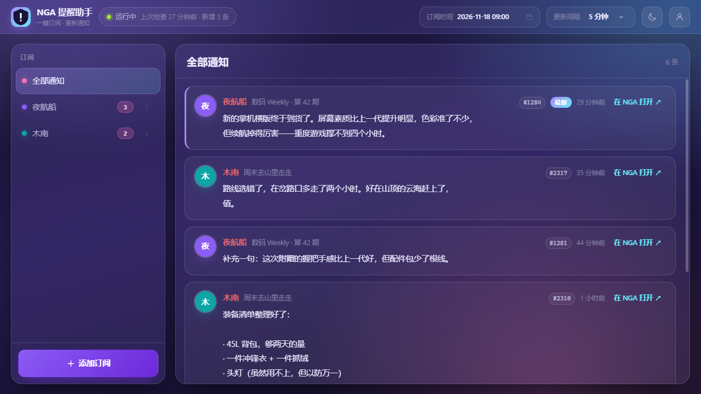
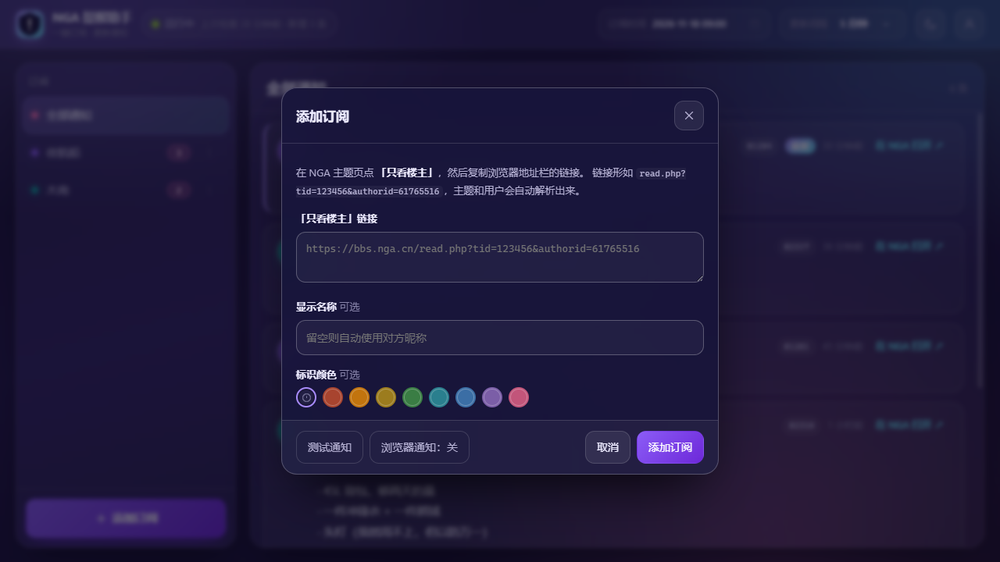
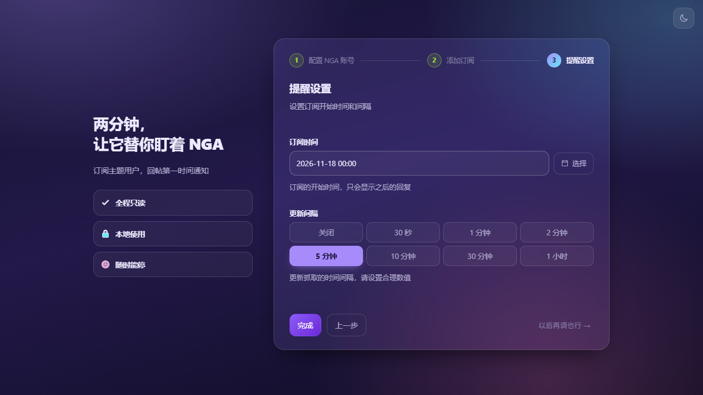

# NGA 提醒助手

订阅 NGA 指定主题里的用户。他们发了新回复，助手会收录到通知列表，并在通知通道可用时提醒你。同一个主题可以订阅多位用户。



## 启动

**直接运行**适合需要系统桌面通知的用户。准备 Python 3.11+ 和 [uv](https://docs.astral.sh/uv/) 后，在项目目录运行：

```bash
uv sync
uv run nga-reminder
```

**Docker Desktop** 用户也可以在项目目录运行：

```bash
docker compose up -d --build
```

两种方式都使用 [本机界面](http://127.0.0.1:8765/)。Docker 将订阅和设置保存在 `nga-data` 数据卷，重建容器会保留这些数据。

## 添加第一条订阅

1. 登录 [NGA](https://bbs.nga.cn)，按 F12，在「应用 / Application → Cookies」复制 `ngaPassportUid` 和 `ngaPassportCid`，分别填进引导页的账号设置。
2. 在 NGA 复制包含 `tid` 和 `authorid` 的主题链接。订阅楼主时，可以直接复制「只看楼主」的链接。订阅其他用户时，可以填写 `tid=主题ID&authorid=用户UID`。
3. 设置订阅起始时间与更新间隔。起始时间设在未来时，助手到点后开始检查。

| 添加订阅 | 设置提醒 |
| --- | --- |
|  |  |

通知列表显示回复内容和发帖时间，点楼层链接可在 NGA 查看原帖。匿名回复无法按用户订阅。

## Docker 桌面通知

Docker 容器通过宿主机上的桥接程序发送系统通知。先在项目目录的 `.env` 中设置同一随机口令：

```dotenv
NGA_BRIDGE_TOKEN=your-random-token
NGA_NOTIFY_WEBHOOK_TOKEN=your-random-token
```

重新执行 `docker compose up -d`，再在宿主机运行：

```bash
uv sync
uv run python scripts/notify_bridge.py
```

Windows 和 macOS 可直接运行。Linux 桌面需要安装 `notify-send`，例如 Ubuntu 的 `libnotify-bin`。打开「添加订阅 → 测试通知」确认通道。如需浏览器通知，在同一窗口开启并允许网页通知权限，使用时保留网页。

## 抓取频率与使用边界

助手通过只读接口查询回复。默认每 60 秒检查一轮，界面最短档位为 30 秒，请求基础间隔为 330 ms。Cookie 保存在本机。使用说明和来源见 [COMPLIANCE.md](COMPLIANCE.md)、[NGA 用户协议](https://bbs.nga.cn/misc/legal/1/agreement.html)、[通用版规](https://bbs.nga.cn/read.php?tid=22586501) 和 [robots.txt 地址](https://bbs.nga.cn/robots.txt)。

## 开发沙盒

```bash
docker compose -f compose.sandbox.yml up -d --build
```

打开 [沙盒界面](http://127.0.0.1:18765/)。沙盒有独立数据卷和内部网络，使用模拟 NGA 与通知接收器。用 `10001` 和 `sandbox` 配置账号，订阅 `tid=101&authorid=20001`，然后注入一条回复：

```bash
docker compose -f compose.sandbox.yml exec mock python /sandbox/mock_nga.py reply 101 20001 "沙盒测试回复"
```

沙盒默认关闭定时检查。执行 `curl -X POST http://127.0.0.1:18765/api/check` 手动检查，在网页查看通知列表。用 `docker compose -f compose.sandbox.yml logs mock` 查看模拟通知，模拟回复会随模拟容器重启清空。

```bash
uv sync --extra dev
uv run pytest
uv run ruff check src tests scripts
```

## 许可

MIT。协议实现参考 [ngapost2md](https://github.com/ludoux/ngapost2md)、[nga-hub-skill](https://github.com/beckyeeky/nga-hub-skill) 和 [NGA-Post-Saver](https://github.com/xhoxye/NGA-Post-Saver)。
